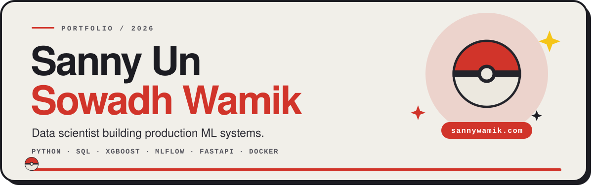

  
  
  

  <a href="#featured-work">Work</a> &nbsp;·&nbsp;
  <a href="#stack">Stack</a> &nbsp;·&nbsp;
  <a href="#the-portfolio-site">The site</a> &nbsp;·&nbsp;
  <a href="#contact">Contact</a>

## About

Final-year Data Science student at **RMIT University** (graduating 2027). I build machine-learning models, and the pipelines and APIs that carry them into production. Three of my projects run as live, documented services with MLflow tracking and CI/CD.

I'm just as comfortable in SQL and Power BI or Tableau, turning large, messy datasets into decisions people can act on.

| Quick facts | |
|---|---|
| **Studying** | B. Data Science, RMIT (expected 2027) |
| **Focus** | Machine learning, MLOps, data pipelines, analytics |
| **Status** | Open to data science roles |
| **Based in** | Melbourne, Australia |

## Featured work

<table>
  <tr>
    <th align="left">Project</th>
    <th align="left">What it does</th>
    <th align="left">Result</th>
    <th align="left">Links</th>
  </tr>
  <tr>
    <td><b>Stock-price forecasting</b> Python · XGBoost · LSTM · MLflow · FastAPI</td>
    <td>Predicts next-day ASX direction using RSI, MACD and Bollinger features, validated with leakage-free walk-forward CV across 10 equities (18,460 samples). Served behind a FastAPI <code>/predict</code> endpoint and Streamlit, with an MLflow registry, pytest and GitHub Actions CI.</td>
    <td><b>51.8%</b> directional accuracy vs 48.8% baseline</td>
    <td><a href="https://sanny2005-asx-stock-forecaster.hf.space/">Live</a> · <a href="https://sanny2005-asx-forecaster-api.hf.space/docs">API</a> · <a href="https://github.com/Sanny-Un-Sowadh-Wamik/stock-forecasting-mlops">Code</a></td>
  </tr>
  <tr>
    <td><b>Real-time fraud detection</b> Python · XGBoost · SMOTE · SHAP · FastAPI WebSocket</td>
    <td>Scores 284,807 credit-card transactions (0.17% fraud) with a cost-sensitive XGBoost and Isolation Forest ensemble and train-only SMOTE. SHAP reason codes stream live over a WebSocket into Alert, Review and OK.</td>
    <td><b>85.9%</b> of fraud caught at <b>84.7%</b> precision PR-AUC 0.88 · ROC-AUC 0.99</td>
    <td><a href="https://sanny2005-realtime-fraud-detection.hf.space/">Live</a> · <a href="https://sanny2005-fraud-detection-api.hf.space/docs">API</a> · <a href="https://github.com/Sanny-Un-Sowadh-Wamik/realtime-fraud-detection">Code</a></td>
  </tr>
  <tr>
    <td><b>Melbourne suburb liveability index</b> Python · GeoPandas · PCA · Folium · Streamlit</td>
    <td>Ranks 260 Greater Melbourne suburbs on an 8-dimension liveability score, using real suburb-boundary geometry. PCA sets the weights instead of hand-picking them. Ships as an interactive choropleth that re-scores as you move the sliders.</td>
    <td><b>260</b> suburbs PC1 explains 42% of variance</td>
    <td><a href="https://sanny2005-melbourne-liveability.hf.space/">Live</a> · <a href="https://github.com/Sanny-Un-Sowadh-Wamik/melbourne-liveability">Code</a></td>
  </tr>
  <tr>
    <td><b>Vaultr, AI cashback engine</b> Next.js 14 · TypeScript · Apify · Claude API</td>
    <td>A <code>/api/cashback</code> service that pulls live offers from five vetted Australian networks, runs a Claude pass to drop untrusted sources, and ranks what is left by the user's own spending. Three fallback tiers keep the feed loading.</td>
    <td>Live offers, ranked per user</td>
    <td><a href="https://github.com/Sanny-Un-Sowadh-Wamik/thevaultr">Code</a></td>
  </tr>
</table>

<b>More projects</b> (13)

 

| Project | About | Stack |
|---|---|---|
| [Click & Collect analysis](https://github.com/Sanny-Un-Sowadh-Wamik/Click-Collect-Product-Analyst-Case-Study) | Funnel analysis across 110M events and 5.3M users | Python, SQL |
| [RFM segmentation](https://github.com/Sanny-Un-Sowadh-Wamik/RFM-customer-segmentation-analysis) | K-Means customer segments | Python |
| [Uber ride analytics 2024](https://github.com/Sanny-Un-Sowadh-Wamik/Uber-Ride-Analytics-2024---Data-Science-Project) | Demand and surge-pricing analysis | Python, Jupyter |
| [Depression risk prediction](https://github.com/Sanny-Un-Sowadh-Wamik/Depression-Prediction-Project) | Logistic regression, random forest and XGBoost compared | Jupyter |
| [House prices prediction](https://github.com/Sanny-Un-Sowadh-Wamik/House-Prices-Prediction) | Regression modelling and feature selection | Jupyter |
| [Titanic survival](https://github.com/Sanny-Un-Sowadh-Wamik/Titanic---Machine-Learning-from-Disaster) | Kaggle classification challenge | Jupyter |
| [F1 race analysis](https://github.com/Sanny-Un-Sowadh-Wamik/f1_analysis) | Telemetry and strategy analysis | Python |
| [Netflix movies EDA](https://github.com/Sanny-Un-Sowadh-Wamik/Investigating-Netflix-Movies) | Exploratory data analysis | Jupyter |
| [Interpol global map](https://github.com/Sanny-Un-Sowadh-Wamik/The-Global-Hunt-Mapping-Interpol-s-Most-Wanted) | Geospatial mapping in R | R |
| [bizbleed](https://github.com/Sanny-Un-Sowadh-Wamik/bizbleed) | Full-stack web app | TypeScript |
| [Store.AI](https://github.com/Sanny-Un-Sowadh-Wamik/Store.AI) | AI-powered commerce app | TypeScript |
| [MusicBot](https://github.com/Sanny-Un-Sowadh-Wamik/MusicBot) | Discord music bot | Python |
| [Transit delay prediction](https://github.com/Sanny-Un-Sowadh-Wamik/Predicting-Public-Transport-Delays-Using-Weather-Events) | Predicting delays from weather events | Jupyter |

## Stack

| Area | Tools |
|---|---|
| **Languages** | `Python` `SQL` `R` |
| **Machine learning** | `XGBoost` `LightGBM` `LSTM` `Time-series` `SMOTE` `PCA` `A/B testing` |
| **MLOps and tooling** | `scikit-learn` `Optuna` `SHAP` `MLflow` `FastAPI` `Docker` `GitHub Actions` `WebSockets` |
| **Data** | `pandas` `NumPy` `Spark` `Hadoop` `PostgreSQL` `Supabase` `GeoPandas` `ETL/ELT` |
| **Visualisation** | `Power BI` `Tableau` `Streamlit` `Plotly` `Matplotlib` `Seaborn` |
| **Workflow** | `Git` `Jupyter` `Linux` `pytest` `n8n` |

## The portfolio site

[**sannywamik.com**](https://www.sannywamik.com) is built to be played with, not just read. A few things worth finding:

- **A Poké Ball scroll scrubber.** The ball under the nav is the page position: drag it to fly through the site, tap it for the next section, hold it to return to the top, and watch it catch the page at the bottom.
- **Stacking project cards** that pin and shrink as the next one slides over, and animations that replay when you scroll back up.
- **A filterable "All works" grid** and a **searchable Data Stack** where tools swell under your cursor.
- **An interactive Data Lab:** beat a fraud-detection model, break a regression, train a neural net live in the browser, and try to out-guess a noisy market. Collect every card in the Data Dex.
- **English and 日本語**, a full-screen mobile menu, keyboard support, and a Reduce Motion mode that turns the animation off.

Built with TanStack Start, React 19, Vite, Tailwind CSS and Vercel. The source of the current version is on the [`portfolio-react` branch](https://github.com/Sanny-Un-Sowadh-Wamik/Sanny-Un-Sowadh-Wamik/tree/portfolio-react).

## GitHub

  

## Contact

Open to data science roles and collaboration. The quickest way to reach me is email.

  
  
  

Let's build something with data.

